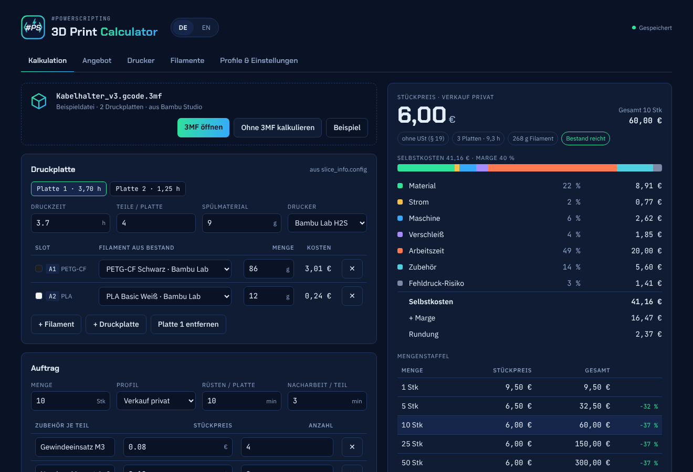

<p align="center">
  
</p>

<h1 align="center">3D Print Calculator</h1>

<p align="center">
  Kostenrechner und Angebotsersteller für den 3D-Druck – als <b>Windows-App</b> und als <b>Webapp im Docker-Container</b>.<br>
  <i>Cost calculator and quote generator for 3D printing – as a <b>Windows app</b> and as a <b>web app in Docker</b>.</i>
</p>

<p align="center">
  <a href="https://github.com/Qu3ntyn83/3D-Print-Calculator/releases/latest"></a>
  <a href="https://github.com/Qu3ntyn83/3D-Print-Calculator/pkgs/container/3d-print-calculator"></a>
  
  
</p>

<p align="center"></p>

**[Deutsch](#deutsch) · [English](#english)**

---

## Deutsch

### Was kann das Tool?

- **3MF-Import** aus Bambu Studio und OrcaSlicer: Druckzeit, Filamentmenge je Slot und Druckplatten werden aus der geslicten Datei gelesen, Filamente automatisch deinem Bestand zugeordnet.
- **Eigene Projekte ohne 3MF**: Druckzeit, Teile pro Platte und Filamente selbst eintragen, beliebig viele Druckplatten.
- **Vollständige Kalkulation**: Material inkl. Spülmaterial, Strom, Maschinenabschreibung, Verschleiß, Arbeitszeit, Zubehör, Fehldruck-Risiko, Marge, MwSt und Rundung – mit Aufschlüsselung und Mengenstaffel.
- **Angebote als PDF** mit eigenem Logo, deinen Absender- und Bankdaten und der Kundenadresse; Hinweis nach § 19 UStG für Kleinunternehmer.
- **Stammdaten**: Drucker, Filamente (mit Farbe und Bestand) und Preisprofile wie „Freunde & Familie“, „Verkauf privat“, „Gewerblich“.
- **Zweisprachig** (Deutsch/Englisch) und **14 Währungen** (EUR, USD, GBP, CHF, PLN, CZK, SEK, DKK, NOK, HUF, CAD, AUD, JPY, CNY).

### Windows-App (ohne Docker)

1. Unter [Releases](https://github.com/Qu3ntyn83/3D-Print-Calculator/releases/latest) die Datei `3D-Print-Calculator_x.y.z_x64-setup.exe` herunterladen.
2. Installer starten – keine Administratorrechte nötig.
3. Fertig. Die App läuft komplett offline.

Deine Daten liegen in `%APPDATA%\de.powerscripting.printcalculator\data.json`. Zum Sichern einfach diese Datei kopieren.

> Windows SmartScreen kann beim ersten Start warnen, weil der Installer nicht signiert ist: „Weitere Informationen“ → „Trotzdem ausführen“.

### Webapp im Docker

```yaml
services:
  3d-print-calculator:
    image: ghcr.io/qu3ntyn83/3d-print-calculator:latest
    container_name: 3d-print-calculator
    restart: unless-stopped
    ports:
      - "8096:8080"
    environment:
      - TZ=Europe/Berlin
    volumes:
      - ./data:/data
```

```bash
docker compose up -d
```

Danach ist die Webapp unter `http://<host>:8096` erreichbar. Alle Daten liegen in einer SQLite-Datenbank unter `./data/calculator.db`.

| Variable | Standard | Bedeutung |
|---|---|---|
| `PORT` | `8080` | Port im Container |
| `DATA_DIR` | `/data` | Ablage der Datenbank |
| `PUID` / `PGID` | `1000` | Besitzer der Dateien in `/data` |

Die Webapp hat **keine eigene Anmeldung**. Wenn sie aus dem Internet erreichbar sein soll, gehört sie hinter einen Reverse Proxy mit Authentifizierung. Ein Betrieb unter einem Unterpfad (z. B. `/calculator/`) funktioniert ohne weitere Einstellungen.

### So wird gerechnet

| Baustein | Formel |
|---|---|
| Material | Gramm × Preis pro kg ÷ 1000 (+ Spülmaterial zum Preis des ersten Filaments), verteilt auf Teile pro Platte |
| Strom | Druckzeit × Ø Leistung ÷ 1000 × Strompreis |
| Maschine | Druckzeit × Kaufpreis ÷ Lebensdauer |
| Verschleiß | Druckzeit × Verschleiß pro Stunde |
| Arbeitszeit | (Rüsten je Platte + Nacharbeit je Teil) × Stundensatz des Profils |
| Zubehör | Stückpreis × Anzahl je Teil |
| Fehldruck-Risiko | Aufschlag in % auf Material, Strom, Maschine und Verschleiß |
| Verkaufspreis | Selbstkosten × (1 + Marge) × (1 + MwSt, außer Kleinunternehmer), danach Rundung |

### Selbst bauen

Voraussetzungen: Node.js 22.13+ (empfohlen 24), für die Windows-App zusätzlich Rust und die [Tauri-Voraussetzungen](https://tauri.app/start/prerequisites/).

```bash
npm ci
npm run dev        # Oberfläche mit Hot Reload (http://localhost:5173)
npm run build      # Oberfläche nach dist/ bauen
npm start          # Server mit SQLite (http://localhost:8080)
npm run tauri dev  # Windows-App im Entwicklungsmodus
npm run tauri build -- --bundles nsis  # Windows-Installer
```

---

## English

### Features

- **3MF import** from Bambu Studio and OrcaSlicer: print time, filament per slot and build plates are read from the sliced file; filaments are matched to your inventory.
- **Custom projects without 3MF**: enter print time, parts per plate and filaments yourself, with as many build plates as you need.
- **Full costing**: material incl. purge, electricity, machine depreciation, wear, labour, hardware, failure risk, margin, VAT and rounding – with a breakdown and volume pricing.
- **PDF quotes** with your own logo, sender and bank details and the customer's address.
- **Master data**: printers, filaments (colour and stock) and pricing profiles.
- **Bilingual** (German/English) and **14 currencies**.

### Windows app (no Docker)

Download `3D-Print-Calculator_x.y.z_x64-setup.exe` from [Releases](https://github.com/Qu3ntyn83/3D-Print-Calculator/releases/latest) and run it. No admin rights and no internet connection needed. Your data is stored in `%APPDATA%\de.powerscripting.printcalculator\data.json`.

> Windows SmartScreen may warn on first launch because the installer is not code-signed: "More info" → "Run anyway".

### Web app in Docker

Use the `docker-compose.yml` above, then open `http://<host>:8096`. Data is stored in SQLite at `./data/calculator.db`. The web app has **no built-in login** – put it behind an authenticating reverse proxy if it is reachable from the internet.

### Build from source

See the commands in the German section above.

---

## Lizenz / License

MIT © Torsten Weise · [#Powerscripting](https://powerscripting.de)

Die PDF-Angebote nutzen IBM Plex Sans (SIL Open Font License 1.1, siehe `src/assets/fonts/OFL.txt`).
